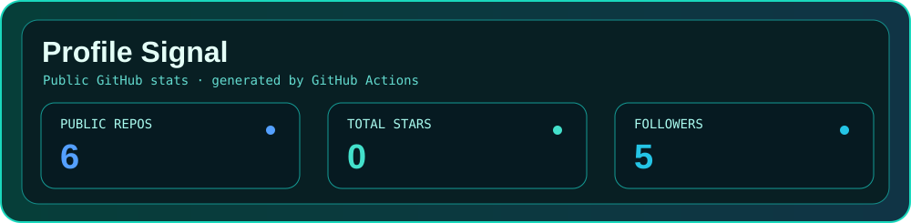
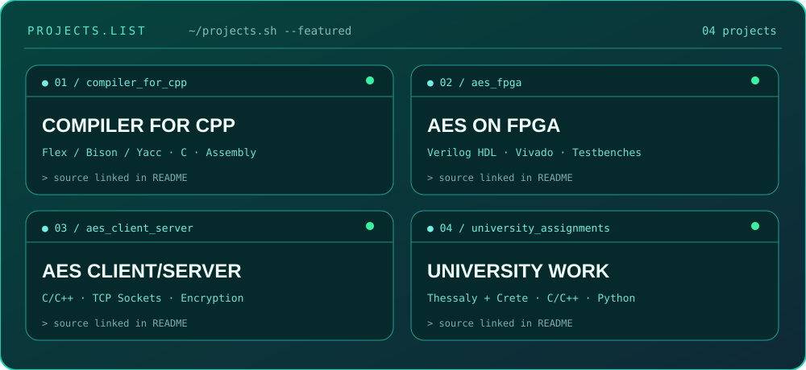
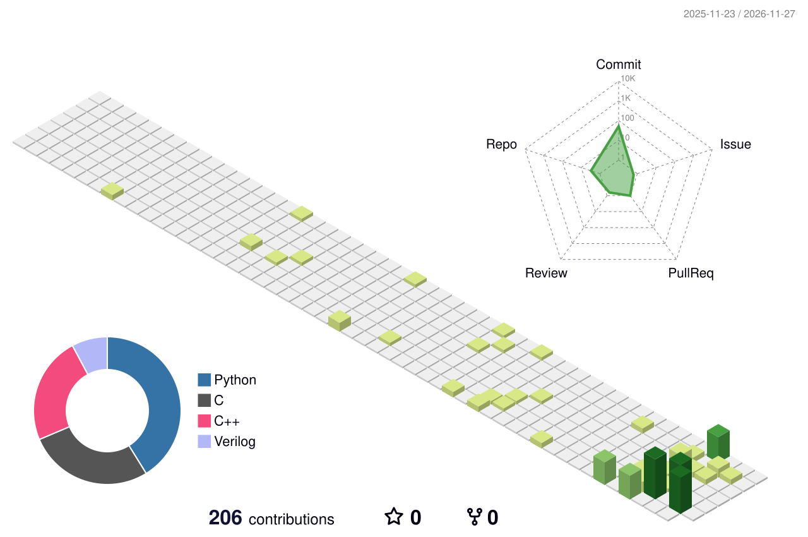

<div align="center">



<br>

[](https://git.io/typing-svg)

**Software Engineer**

</div>

## `> ./about_me.py`

```python
class SoftwareEngineer:
    github = "ZacGeo"
    background = "Informatics & Telecommunications"
    focus = ["Software Development", "Machine Learning", "Hardware Security"]
    tools = ["Python", "C/C++", "Java", "ROS", "SQL", "Linux", "Verilog", "JavaScript", "React"]

    def goal(self):
        return "Build practical, reliable systems and keep learning."
```

## `> ./profile_signal.sh --live`

<div align="center">

<!-- Generated daily by .github/workflows/profile-assets.yml -->


</div>

> Counts above represent public repositories, stars on owned non-fork repositories, and followers. They are generated from the GitHub API; they are not manually claimed contribution counts.

## `> ./tech_stack.sh --list`

<div align="center">

[](https://skillicons.dev)

**Also working with:** SQL · NumPy · Pandas · ROS · Gazebo · MATLAB/Simulink · Scikit-learn · Verilog HDL · AMD Xilinx Vivado · FPGA Development

</div>

## `> ./projects.sh --featured`

<div align="center">



</div>

The four cards above highlight my published university and engineering repositories. Click a project below to explore its source code.

| Project | Description | Technologies |
|:--|:--|:--|
| **[Compiler_for_cpp](https://github.com/ZacGeo/Compiler_for_cpp)** | A university compiler project for a simplified C++-like language, developed at the University of Thessaly. | Yacc, C, Flex, Bison, Assembly |
| **[AES_implementaion_to_FPGA](https://github.com/ZacGeo/AES_implementaion_to_FPGA)** | FPGA-side implementation of an AES thesis project, including synthesizable RTL, simulation testbenches, and constraints. | Verilog HDL, AMD Xilinx Vivado, FPGA |
| **[AES_implementaion_client-server](https://github.com/ZacGeo/AES_implementaion_client-server)** | Client/server software demonstrating AES encryption in TCP communication and comparing observable plaintext and encrypted traffic. | C/C++, TCP sockets, multithreading |
| **[Uni](https://github.com/ZacGeo/Uni)** | Collection of university assignments from the University of Thessaly and the University of Crete. | C/C++, Python, Ray Tracing |

## `> ./contribution_city.sh`

<div align="center">

<!-- Generated on the first successful run of profile-assets.yml -->


</div>

---

<div align="center">

`zacgeo@github:~$ echo "Thanks for visiting!"`

[**Browse repositories**](https://github.com/ZacGeo?tab=repositories) · [**GitHub profile**](https://github.com/ZacGeo)

</div>
